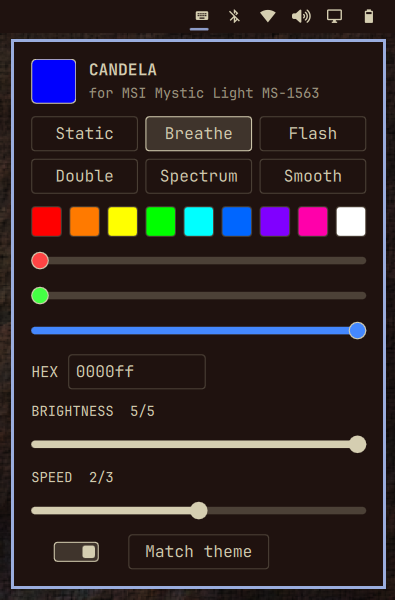

# Candela for MSI Mystic Light

Keyboard backlight panel for [Omarchy](https://omarchy.org) 4. Set the colour, brightness and the keyboard's built-in effects from a panel in the bar. It follows your Omarchy theme if you want it to.




Nothing runs in the background. Each change is one short `openrgb` call, and the last state is restored when the shell starts.

## Supported hardware

MSI laptops with a **Mystic Light MS-1562 / MS-1563 / MS-1564** single-zone USB keyboard controller (USB `1462:1562`, `1462:1563`, `1462:1564`). Check yours:

```sh
lsusb | grep -E "1462:156[234]"
```

| Laptop | USB id | Status |
|---|---|---|
| MSI Alpha 15 B5EEK | 1462:1563 | Tested |
| Other laptops with the same controller (reports exist for Alpha 17 B5EEK, Delta 15 A5EFK, Pulse GL66/GL76) | 1562 / 1564 | Not tested. The device check allows them. Reports welcome. |

Not supported, and the plugin refuses to touch them: per-key and multi-zone MSI keyboards (for example `1462:1601`), SteelSeries keyboards, and MSI motherboard RGB controllers. If no supported controller is found, the panel says so and sends nothing.

## Requirements

- OpenRGB **1.1 or newer** (`yay -S openrgb`). Only 1.1 has been tested.
- coreutils `timeout`.
- Permission to use the device as a normal user. If `openrgb --list-devices` shows nothing without sudo, install [`udev/70-candela.rules`](udev/70-candela.rules).

## Install

```sh
omarchy plugin add https://github.com/SanayScripts/omarchy-candela-mystic-light.git --enable
```

Remove:

```sh
omarchy plugin remove io.github.sanayscripts.candela-mystic-light
```

Removing the plugin leaves its small state file behind. Delete it if you want a clean slate:

```sh
rm -r ~/.local/state/candela-mystic-light
```

The keyboard keeps its last colour until the next reboot. If you installed the optional udev rule, remove it with `sudo rm /etc/udev/rules.d/70-candela.rules`.

## Use

Click the keyboard icon in the bar.

- **Modes:** Static, Breathe, Flash, Double, Spectrum, Smooth. The hardware runs the effects itself.
- **Colour:** presets, RGB sliders, a hex field. **Match theme** sets the keyboard to your theme colour and keeps it there. Spectrum modes ignore the colour.
- **Brightness:** 5 steps, the same as the hardware.
- **Speed:** 3 steps for the animated modes.
- **Power switch** (on/off, like the other Omarchy widgets) and **Match theme**.

Sliders send one command when you let go, not while dragging.

State is saved to `$XDG_STATE_HOME/candela-mystic-light/state.json` (default `~/.local/state/candela-mystic-light/state.json`).

## What it does and does not do

- Runs `timeout 5 openrgb ...` with a fixed argument list. Every value is validated first: modes come from a fixed list, colours must be six hex digits, numbers are clamped. There is no shell string building.
- Reads USB ids from `/sys/bus/usb/devices` and OpenRGB's device list. It finds the keyboard by name, not by position, and looks it up again once if a call fails.
- Makes no network calls and reads no files other than its own state file.
- Needs no root. The only step that needs `sudo` is installing the optional udev rule, and the plugin never does that for you.
- Plugins run unsandboxed in the Omarchy shell. Read `Panel.qml` and `Logic.js` before enabling.

## Known limits

- The backlight is not restored after suspend, only when the shell starts.
- The brightness and speed steps assume OpenRGB maps percentages onto the hardware's five and three levels. Which end of the speed scale is faster is not verified.
- The panel cannot read the keyboard's real state, so it shows its last saved state.
- No keyboard navigation inside the panel yet.

## Development

```sh
./bin/test
```

Runs, in order: unit and integration tests in Node against a strict fake `openrgb` (including hung, failing, old and missing OpenRGB, other MSI controller ids, hostile input and fuzzing), the same logic inside Qt's JS engine with `qmltestrunner`, `omarchy plugin validate` and `qmllint` when Omarchy is installed. The checks that need the real keyboard are in [docs/MANUAL_TESTS.md](docs/MANUAL_TESTS.md).

## Credits

Controller identification comes from the OpenRGB issue tracker (#2289, #2003, #2054) and the Linux hardware database.

MIT licensed.
